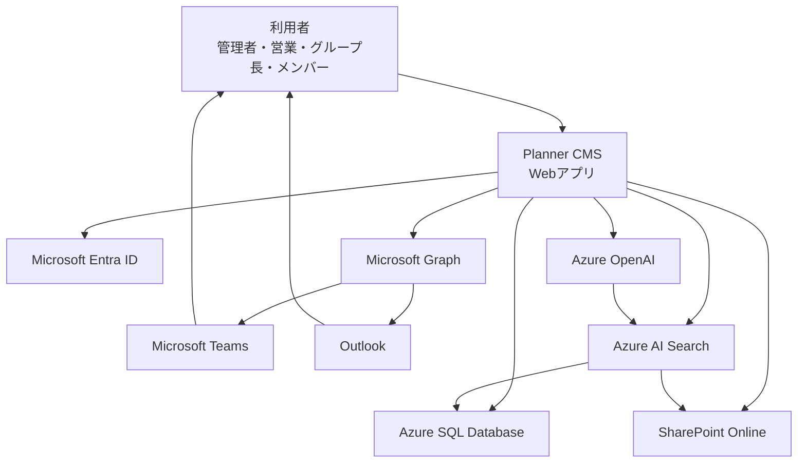
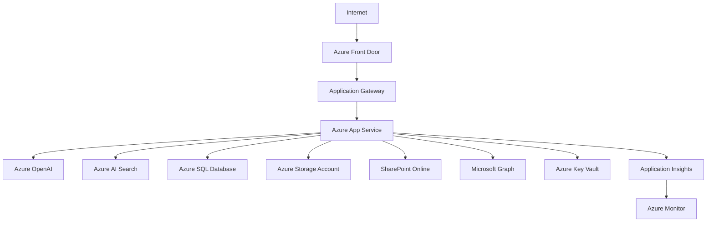
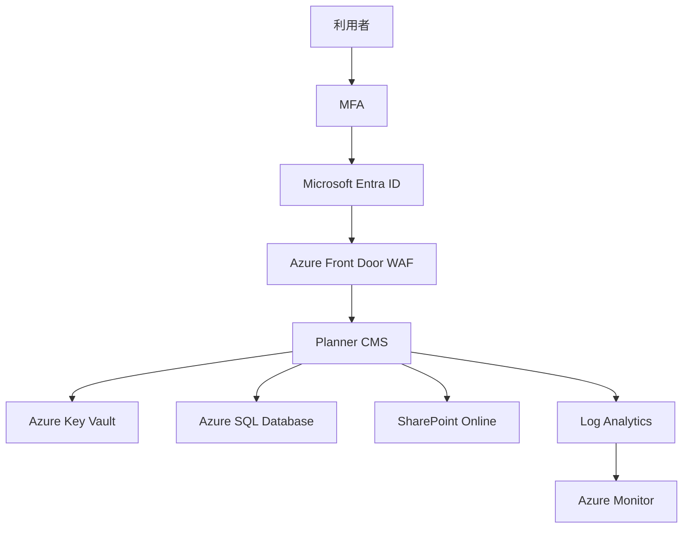
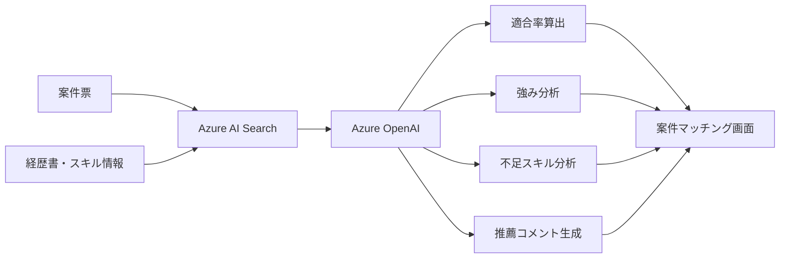

# Planner CMS システム構成図

## システム概要

Planner CMSは、人材紹介・SES向けの案件管理システムであり、以下の業務を統合管理する。

- 募集案件管理
- 参画案件管理
- 要員管理
- スキル管理
- 経歴書管理
- AIマッチング
- 提案活動管理
- 契約管理
- Teams通知
- Outlook連携

システムは Microsoft 365 および Azure サービスを活用したクラウドネイティブ構成とする。

---

# システム利用者

## 管理者

- ユーザー管理
- グループ管理
- マスタ管理
- KPI管理

## 営業担当

- 募集案件管理
- 提案管理
- 面談管理
- 契約管理

## グループ長

- 参画案件管理
- 現場フォロー
- 契約更新確認

## メンバー

- 経歴書更新
- 勤怠提出
- 現場状況入力

---

# システム構成

## フロントエンド

### Planner CMS Webアプリ

主な機能

- ダッシュボード
- 募集案件管理
- 参画案件管理
- ユーザー管理
- グループ管理
- AIマッチング
- 通知管理

実装候補

- React
- TypeScript
- Fluent UI
- Microsoft Authentication Library (MSAL)

---

# 認証基盤

## Microsoft Entra ID

利用機能

- シングルサインオン（SSO）
- 多要素認証（MFA）
- ロール管理

ロール

- 管理者
- 営業
- グループ長
- メンバー

---

# Microsoft Graph

取得情報

- ユーザー情報
- 組織情報
- Outlook予定表
- Teams情報

利用機能

- Teams通知
- Outlook連携
- ユーザー同期

---

# SharePoint Online

保存対象

- 経歴書
- 契約書
- 勤怠表
- 案件資料

機能

- バージョン管理
- 権限管理
- ファイル検索

---

# Azure SQL Database

管理データ

- ユーザー情報
- スキル情報
- 資格情報
- 募集案件
- 参画案件
- 面談履歴
- 提案履歴
- 契約情報
- 勤怠情報
- 現場状況
- 通知履歴
- AI生成履歴

---

# Azure AI Search

インデックス対象

- 経歴書
- 案件票
- スキル情報
- 契約情報

利用機能

- 類似案件検索
- 類似人材検索
- ベクトル検索
- RAG検索

---

# Azure OpenAI

利用機能

- AIマッチング
- 自己PR生成
- 経歴書生成
- 提案文生成
- 面談要約
- 案件要約

---

# Microsoft Teams

通知

- 面談通知
- 提案依頼
- 契約更新通知
- 退場予定アラート
- 勤怠未提出通知

---

# Outlook

通知

- 面談依頼
- 契約通知
- 案件更新通知

---

# Azureリソース構成

## Application Layer

- Azure App Service
- Azure Front Door（推奨）
- Azure Application Gateway（推奨）

---

## Service Layer

- Azure OpenAI
- Azure AI Search
- Microsoft Graph

---

## Data Layer

- Azure SQL Database
- SharePoint Online
- Azure Storage Account（将来）

---

## Monitoring Layer

- Azure Monitor
- Application Insights
- Log Analytics Workspace

---

# セキュリティ設計

## 認証

- Microsoft Entra ID
- MFA必須

---

## 認可

RBAC制御

管理者
- 全権限

営業
- 募集案件管理
- 提案管理

グループ長
- 参画案件管理
- 担当メンバー管理

メンバー
- 自身の情報のみ編集

---

## 通信

- HTTPS/TLS 1.2以上
- Front Door経由通信

---

## データ保護

- Azure SQL Transparent Data Encryption
- SharePoint暗号化
- Key Vaultによる秘密情報管理

---

## 監査

監査対象

- ログイン
- ファイルダウンロード
- 権限変更
- AI実行履歴
- データ更新履歴

保存先

- Log Analytics
- Application Insights

---

# AIマッチング処理

案件票
↓
Azure AI Search検索
↓
候補者抽出
↓
Azure OpenAI評価
↓
適合率算出
↓
推薦コメント生成
↓
案件マッチング画面表示

---

# 今後の拡張

- Power BI連携
- Teams Bot
- Copilot Studio
- Azure Blob Storage
- Azure Functions
- Logic Apps

# Planner CMS システム構成図（Mermaid形式）

# Azureリソース構成図（Mermaid）

# セキュリティ構成図（Mermaid）

# AIマッチングアーキテクチャ（Mermaid）
