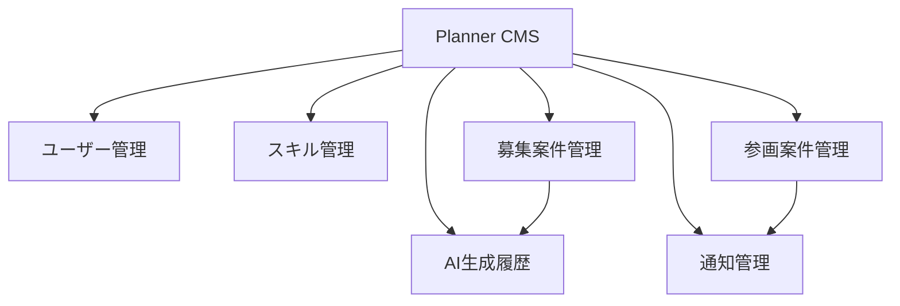

# Planner CMS DB構成

## 概要

Planner CMSでは以下の領域を管理する。

- ユーザー管理
- スキル管理
- 経歴書管理
- 募集案件管理
- 参画案件管理
- 面談管理
- 提案管理
- 勤怠管理
- 現場フォロー管理
- AIマッチング管理
- 通知管理

---

# ER構成

ユーザー
├─ スキル
├─ 資格
├─ 経歴書
├─ 勤怠
├─ 現場状況
├─ 通知
└─ 案件参画

募集案件
├─ 提案履歴
├─ 面談履歴
├─ AIマッチング
└─ チャット

参画案件
├─ 案件参画者
├─ 勤怠
├─ 現場状況
├─ 延長確認
└─ チャット

---

# マスタテーブル

## m_users

ユーザー情報

|項目|型|
|---|---|
|user_id(PK)|UUID|
|employee_no|VARCHAR(20)|
|name|VARCHAR(100)|
|email|VARCHAR(255)|
|group_id(FK)|UUID|
|office_id(FK)|UUID|
|status|VARCHAR(30)|
|role|VARCHAR(30)|
|join_date|DATE|
|retire_date|DATE|
|created_at|DATETIME|
|updated_at|DATETIME|

---

## m_groups

|項目|型|
|---|---|
|group_id(PK)|UUID|
|group_name|VARCHAR(100)|
|leader_user_id(FK)|UUID|

---

## m_offices

|項目|型|
|---|---|
|office_id(PK)|UUID|
|office_name|VARCHAR(100)|

---

## m_skills

|項目|型|
|---|---|
|skill_id(PK)|UUID|
|skill_name|VARCHAR(100)|
|category|VARCHAR(50)|

カテゴリ

- 言語
- DB
- クラウド
- FW
- OS
- ツール
- 業界

---

## m_certifications

|項目|型|
|---|---|
|certification_id(PK)|UUID|
|certification_name|VARCHAR(200)|

---

# ユーザー管理

## t_user_skills

|項目|型|
|---|---|
|id(PK)|UUID|
|user_id(FK)|UUID|
|skill_id(FK)|UUID|
|experience_years|DECIMAL(4,1)|
|skill_level|INT|

---

## t_user_certifications

|項目|型|
|---|---|
|id(PK)|UUID|
|user_id(FK)|UUID|
|certification_id(FK)|UUID|
|acquired_date|DATE|

---

## t_resumes

経歴書情報

|項目|型|
|---|---|
|resume_id(PK)|UUID|
|user_id(FK)|UUID|
|resume_json|JSON|
|sharepoint_url|VARCHAR(1000)|
|version_no|INT|
|updated_at|DATETIME|

---

# 募集案件管理

## t_recruit_projects

|項目|型|
|---|---|
|project_id(PK)|UUID|
|project_name|VARCHAR(300)|
|project_detail|TEXT|
|priority|INT|
|location|VARCHAR(200)|
|unit_price|DECIMAL(10,0)|
|contract_type|VARCHAR(50)|
|settlement_min|INT|
|settlement_max|INT|
|status|VARCHAR(30)|
|created_user_id(FK)|UUID|
|created_at|DATETIME|

---

## t_project_proposals

提案履歴

|項目|型|
|---|---|
|proposal_id(PK)|UUID|
|project_id(FK)|UUID|
|candidate_user_id(FK)|UUID|
|proposal_date|DATETIME|
|proposal_comment|TEXT|

---

## t_project_interviews

面談履歴

|項目|型|
|---|---|
|interview_id(PK)|UUID|
|project_id(FK)|UUID|
|candidate_user_id(FK)|UUID|
|interview_date|DATETIME|
|interview_count|INT|
|result|VARCHAR(50)|
|memo|TEXT|

---

# AIマッチング

## t_project_matching

|項目|型|
|---|---|
|matching_id(PK)|UUID|
|project_id(FK)|UUID|
|user_id(FK)|UUID|
|match_score|DECIMAL(5,2)|
|strengths|TEXT|
|weaknesses|TEXT|
|recommend_comment|TEXT|
|created_at|DATETIME|

---

# 参画案件管理

## t_assign_projects

|項目|型|
|---|---|
|assign_project_id(PK)|UUID|
|project_name|VARCHAR(300)|
|start_date|DATE|
|end_date|DATE|
|status|VARCHAR(30)|
|customer_name|VARCHAR(200)|

---

## t_project_members

参画者

|項目|型|
|---|---|
|member_id(PK)|UUID|
|assign_project_id(FK)|UUID|
|user_id(FK)|UUID|
|assign_start_date|DATE|
|assign_end_date|DATE|

---

# 勤怠管理

## t_attendance

|項目|型|
|---|---|
|attendance_id(PK)|UUID|
|user_id(FK)|UUID|
|target_month|CHAR(7)|
|work_hours|DECIMAL(5,2)|
|overtime_hours|DECIMAL(5,2)|
|sharepoint_file_url|VARCHAR(1000)|
|submitted_at|DATETIME|

---

# 現場状況管理

## t_field_reports

|項目|型|
|---|---|
|report_id(PK)|UUID|
|user_id(FK)|UUID|
|assign_project_id(FK)|UUID|
|health_score|INT|
|motivation_score|INT|
|site_score|INT|
|extension_intention|VARCHAR(20)|
|comment|TEXT|
|report_month|CHAR(7)|

---

# 契約延長管理

## t_extension_confirmations

|項目|型|
|---|---|
|extension_id(PK)|UUID|
|assign_project_id(FK)|UUID|
|user_id(FK)|UUID|
|result|VARCHAR(30)|
|reason|TEXT|
|confirmed_at|DATETIME|

---

# 通知管理

## t_notifications

|項目|型|
|---|---|
|notification_id(PK)|UUID|
|user_id(FK)|UUID|
|title|VARCHAR(300)|
|message|TEXT|
|notification_type|VARCHAR(50)|
|is_read|BIT|
|created_at|DATETIME|

---

# AI生成履歴

## t_ai_generation_logs

|項目|型|
|---|---|
|log_id(PK)|UUID|
|user_id(FK)|UUID|
|generation_type|VARCHAR(50)|
|prompt|TEXT|
|result_text|TEXT|
|created_at|DATETIME|

種別

- 経歴書生成
- 自己PR生成
- 提案文生成
- マッチング分析

---

# 将来追加テーブル

## 営業管理

- t_clients
- t_business_partners
- t_sales_activities

## 契約管理

- t_contracts
- t_contract_documents

## KPI

- t_kpi_monthly

## チャット

- t_project_chats

## Teams連携履歴

- t_teams_notifications

# DB構成図（Mermaid形式）

```mermaid
erDiagram

    m_users ||--o{ t_user_skills : has
    m_users ||--o{ t_user_certifications : has
    m_users ||--o{ t_resumes : owns
    m_users ||--o{ t_attendance : submits
    m_users ||--o{ t_notifications : receives

    m_groups ||--o{ m_users : belongs

    m_skills ||--o{ t_user_skills : mapped

    m_certifications ||--o{ t_user_certifications : mapped

    t_recruit_projects ||--o{ t_project_proposals : has
    t_recruit_projects ||--o{ t_project_interviews : has
    t_recruit_projects ||--o{ t_project_matching : has

    m_users ||--o{ t_project_proposals : candidate
    m_users ||--o{ t_project_interviews : candidate
    m_users ||--o{ t_project_matching : matched

    t_assign_projects ||--o{ t_project_members : contains

    m_users ||--o{ t_project_members : assigned

    t_assign_projects ||--o{ t_field_reports : reported

    m_users ||--o{ t_field_reports : creates

    t_assign_projects ||--o{ t_extension_confirmations : extension

    m_groups {
        uuid group_id PK
        string group_name
    }

    m_users {
        uuid user_id PK
        string employee_no
        string name
        string email
        string status
        string role
    }

    m_skills {
        uuid skill_id PK
        string skill_name
        string category
    }

    t_user_skills {
        uuid id PK
        uuid user_id FK
        uuid skill_id FK
        decimal experience_years
        int skill_level
    }

    t_resumes {
        uuid resume_id PK
        uuid user_id FK
        string sharepoint_url
        int version_no
    }

    t_recruit_projects {
        uuid project_id PK
        string project_name
        string status
        string location
    }

    t_project_matching {
        uuid matching_id PK
        uuid project_id FK
        uuid user_id FK
        decimal match_score
    }

    t_assign_projects {
        uuid assign_project_id PK
        string project_name
        string status
        date start_date
        date end_date
    }

    t_project_members {
        uuid member_id PK
        uuid assign_project_id FK
        uuid user_id FK
    }

    t_attendance {
        uuid attendance_id PK
        uuid user_id FK
        string target_month
    }

    t_field_reports {
        uuid report_id PK
        uuid user_id FK
        uuid assign_project_id FK
        int health_score
        int motivation_score
    }

    t_extension_confirmations {
        uuid extension_id PK
        uuid assign_project_id FK
        uuid user_id FK
        string result
    }

    t_notifications {
        uuid notification_id PK
        uuid user_id FK
        string notification_type
    }
```

# Azure SQL観点での推奨DBレイヤー構成
