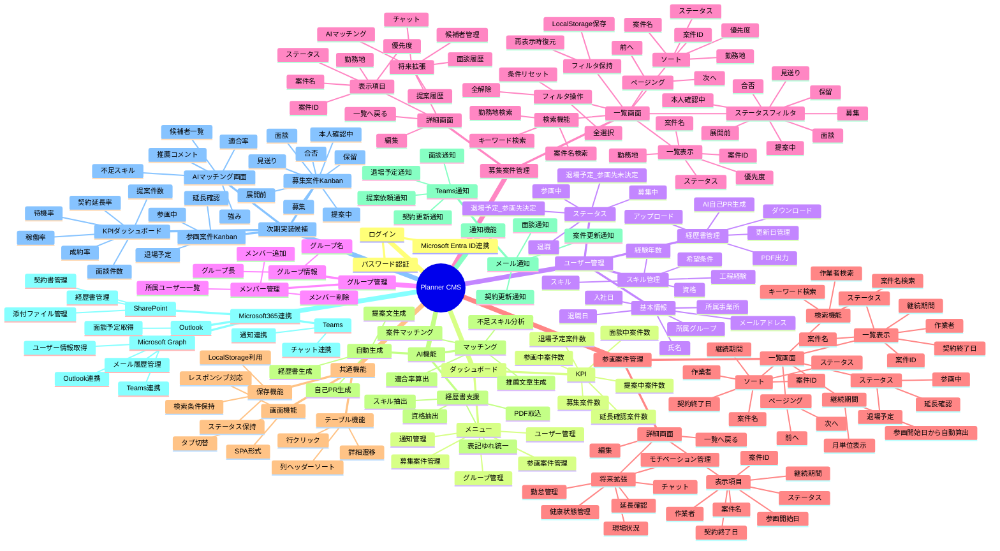

# Planner CMS マインドマップ

## ログイン

- パスワード認証
- Microsoft Entra ID連携（将来対応）

---

# ダッシュボード

## KPI

- 募集案件数
- 提案中案件数
- 面談中案件数
- 参画中案件数
- 延長確認案件数
- 退場予定案件数

## メニュー

- ユーザー管理
- グループ管理
- 募集案件管理
- 参画案件管理
- 通知管理

---

# ユーザー管理

## 基本情報

- 氏名
- 所属グループ
- 所属事業所
- メールアドレス
- 入社日
- 退職日

## スキル管理

- スキル
- 資格
- 経験年数
- 工程経験
- 希望条件

## ステータス

- 募集中
- 参画中
- 退場予定（参画先決定）
- 退場予定（参画先未決定）
- 退職

## 経歴書管理

- アップロード
- ダウンロード
- 更新日管理
- PDF出力
- AI自己PR生成

---

# グループ管理

## グループ情報

- グループ名
- グループ長

## メンバー管理

- 所属ユーザー一覧
- メンバー追加
- メンバー削除

---

# 募集案件管理

## 一覧画面

### 検索機能

- キーワード検索
- 案件名検索
- 勤務地検索

### ステータスフィルタ

- 展開前
- 募集
- 本人確認中
- 提案中
- 面談
- 合否
- 保留
- 見送り

### フィルタ操作

- 全選択
- 全解除
- 条件リセット

### フィルタ状態保持

- LocalStorage保存
- 再表示時復元

### 一覧表示項目

- 案件ID
- 案件名
- ステータス
- 優先度
- 勤務地

### ソート

- 案件ID
- 案件名
- ステータス
- 優先度
- 勤務地

### ページング

- 前へ
- 次へ

---

## 詳細画面

### 画面遷移

案件一覧
↓
案件詳細画面

### ボタン

- 一覧へ戻る
- 編集

### 表示情報

- 案件ID
- 案件名
- ステータス
- 優先度
- 勤務地

### 将来追加予定

- 面談履歴
- 提案履歴
- 候補者管理
- AIマッチング結果
- チャット

---

# 参画案件管理

## 一覧画面

### 検索機能

- キーワード検索
- 案件名検索
- 作業者検索

### 一覧表示項目

- 案件ID
- 案件名
- 作業者
- ステータス
- 継続期間
- 契約終了日

### 継続期間算出

- 参画開始日から自動算出
- 月単位表示

### ステータス

- 参画中
- 延長確認
- 退場予定

### ソート

- 案件ID
- 案件名
- 作業者
- ステータス
- 継続期間
- 契約終了日

### ページング

- 前へ
- 次へ

---

## 詳細画面

### ボタン

- 一覧へ戻る
- 編集

### 表示情報

- 案件ID
- 案件名
- 作業者
- ステータス
- 継続期間
- 参画開始日
- 契約終了日

### 将来追加予定

- 勤怠管理
- 現場状況
- モチベーション管理
- 健康状態管理
- 延長確認
- チャット

---

# 共通機能

## テーブル機能

- 列ヘッダーソート
- 行クリック
- 詳細遷移

## 画面機能

- レスポンシブ対応
- SPA形式
- タブ切替

## 保存機能

- 検索条件保持
- ステータスチェック保持
- LocalStorage利用

---

# AI機能（将来）

## 経歴書支援

- PDF取込
- スキル抽出
- 資格抽出
- 表記ゆれ統一

## 自動生成

- 自己PR生成
- 経歴書生成
- 提案文生成

## マッチング

- 案件マッチング
- 適合率算出
- 不足スキル分析
- 推薦文章生成

---

# 通知機能（将来）

## Teams通知

- 面談通知
- 契約更新通知
- 提案依頼通知
- 退場予定通知

## メール通知

- 案件更新通知
- 面談通知
- 契約更新通知

---

# Microsoft 365連携（将来）

## Microsoft Graph

- ユーザー情報取得
- Outlook連携
- Teams連携

## Outlook

- 面談予定取得
- メール履歴管理

## Teams

- チャット連携
- 通知連携

## SharePoint

- 経歴書管理
- 契約書管理
- 添付ファイル管理

---

# 次期実装候補

## 募集案件 Kanban

- 展開前
- 募集
- 本人確認中
- 提案中
- 面談
- 合否
- 保留
- 見送り

## 参画案件 Kanban

- 参画中
- 延長確認
- 退場予定

## KPIダッシュボード

- 提案件数
- 面談件数
- 成約率
- 稼働率
- 待機率
- 契約延長率

## AIマッチング画面

- 候補者一覧
- 適合率
- 強み
- 不足スキル
- 推薦コメント

# Planner CMS マインドマップ（Mermaid）

